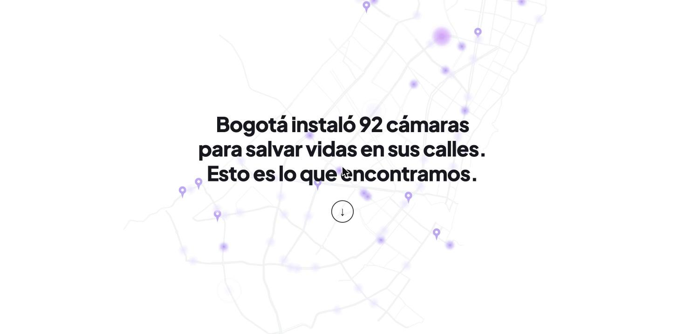
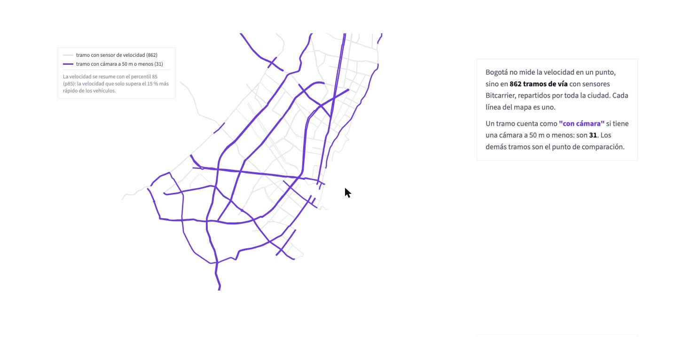
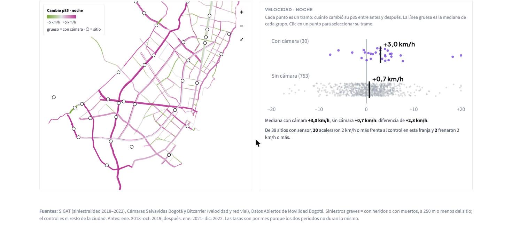

# Cámaras Salvavidas de Bogotá — Visual Analytics

Proyecto de analítica visual sobre las 92 "cámaras salvavidas" (cámaras de control de velocidad) que la Secretaría Distrital de Movilidad instaló en 40 cruces de Bogotá entre noviembre de 2019 y marzo de 2020. La pregunta central: **¿bajó la velocidad cerca de las cámaras, y bajaron ahí los siniestros graves, más que en el resto de la ciudad?**

🔗 **Demo en vivo:** [camaras-salvavidas-visual-analytics.vercel.app](https://camaras-salvavidas-visual-analytics.vercel.app/)

## Contexto

Las cámaras buscan frenar el exceso de velocidad en los puntos con más siniestros. Seis años después de la instalación, este proyecto compara qué pasó sitio por sitio: cómo cambió la velocidad nocturna (percentil 85) y los siniestros graves (con heridos o muertos) a 250 m o menos de cada cámara, frente al resto de la ciudad como control.

No es una prueba causal: el diseño es de diferencias simples antes/después con un grupo de control, sobre datos con limitaciones reales (ver `docs/PROCESO.md`), entre ellas una geocodificación propia de los siniestros de 2018–2021 (no traían coordenadas oficiales) con un error mediano de 170 m.

## Qué hay en el sitio

- **Portada y scrollytelling** (`index.html`) — recorrido guiado: cómo se mide la velocidad, qué cuenta como "sitio", y tres mapas (siniestros, velocidad, coincidencia de ambos) más un gráfico de correlación.
- **Explorador** — mapa interactivo por tramo o por sitio, filtrable por franja horaria y tipo de víctima, con ranking de los sitios donde más cambió cada métrica.
- **Del resultado al mecanismo** (`mecanismo.html`, `mecanismo_v2.html`) — páginas complementarias que profundizan en el mecanismo detrás del resultado.

## Capturas

**Portada**



**Scrollytelling: cómo se mide la velocidad**



**Explorador: velocidad por tramo**



## Datos y pipeline

Los datos crudos (cámaras, siniestralidad SIGAT, velocidad Bitcarrier) se procesan con scripts en `scripts/` hacia `data/clean/` y los `.json`/`.geojson` que consume el sitio. El detalle completo de limpieza, deduplicación, geocodificación propia y sus limitaciones está documentado en `docs/PROCESO.md`.

## Correr en local

```bash
python3 -m http.server 8748
```

y abrir `http://localhost:8748/`. Es un sitio estático sin build: HTML + D3 v7 por CDN.
